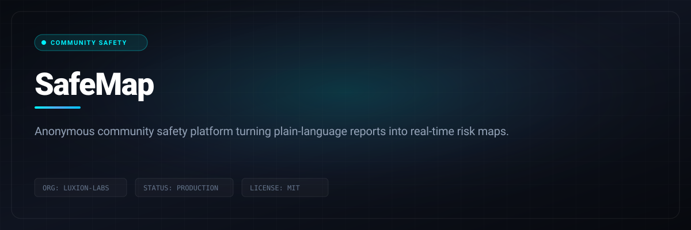

# SafeMap

> Anonymous community safety platform turning plain-language reports into real-time risk maps.

```bash
git clone https://github.com/Luxion-Labs/SafeMap.git && cd SafeMap && npm install && npm run dev
```



[](https://safemap-evorozon.vercel.app) [](LICENSE) [](CONTRIBUTING.md)

## Overview
Anonymous community safety platform turning plain-language reports into real-time risk maps. Built by Luxion Labs as part of our high-velocity open-source engineering ecosystem.

## Features
- Zero identity tracking or account requirements for reporting incidents.
- Natural language incident extraction (location, time, severity categorization).
- Real-time heatmaps and cluster visualization on interactive map tiles.
- Community-verified safety perimeter zones.

## Architecture and Stack
FastAPI, Python, React, Leaflet, OpenStreetMap, and NLP entity extraction.

## Quickstart
```bash
git clone https://github.com/Luxion-Labs/SafeMap.git && cd SafeMap && npm install && npm run dev
```

## Maintainer Response SLA
Luxion Labs enforces a strict 24-hour response SLA on all community issues, feature proposals, and pull requests. See [CONTRIBUTING.md](CONTRIBUTING.md) for full development guidelines.

## License
Distributed under the MIT License. See [LICENSE](LICENSE) for more details.
